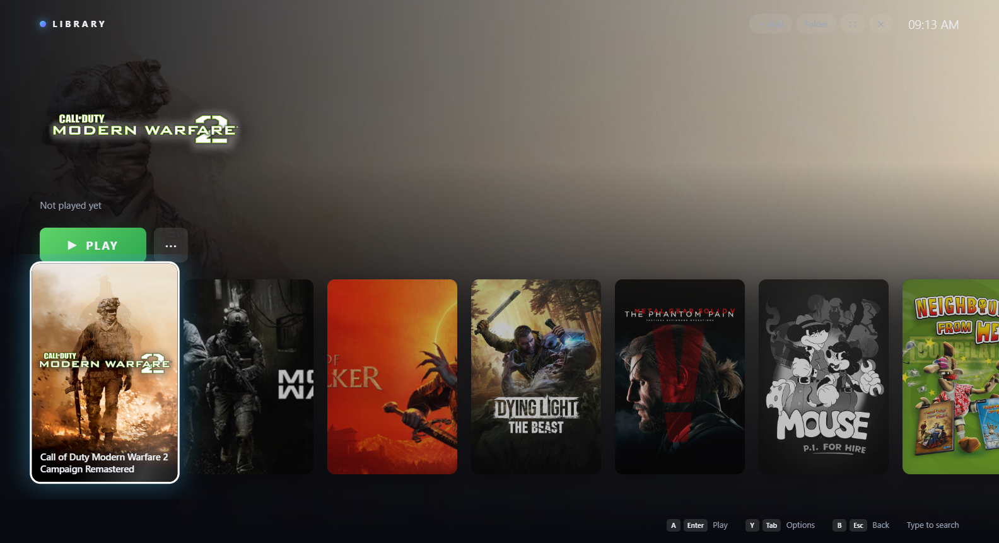
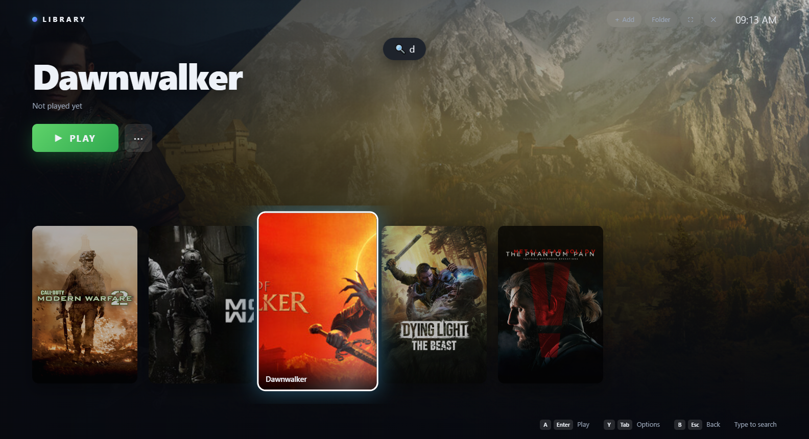
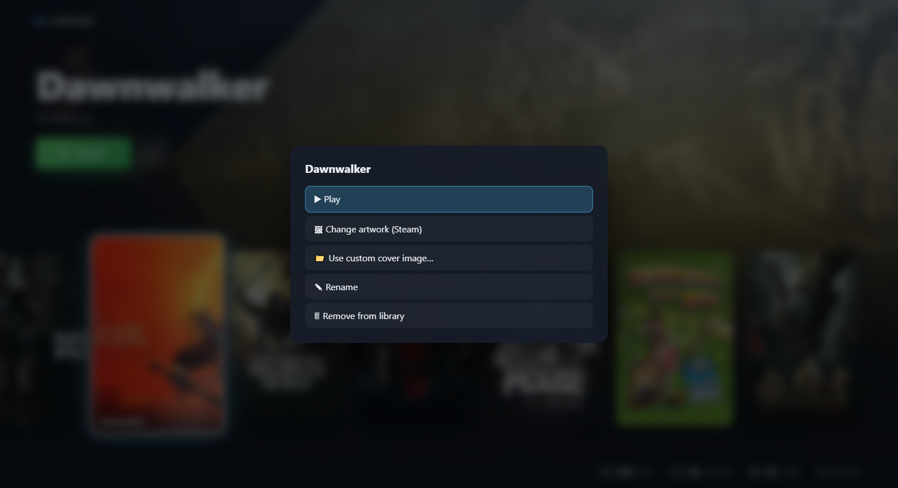

<div align="center">

# 🎮 Game Library

**A console-style, gamepad-friendly launcher for all your PC games, in one place.**

Drop in your shortcuts and it fetches box art, hero banners and logos from Steam on its own.
Browse with a controller from the couch, or with a keyboard from the desk.




</div>

---

## ✨ Features

- **Automatic artwork.** Covers, full-screen hero backgrounds and game logos come from the Steam store, matched by name.
- **Controller support.** Xbox-layout gamepads work out of the box, with the D-pad or stick, bumpers to jump, and a held direction that repeats.
- **Full keyboard control.** Arrow keys, Enter, Tab, Esc, Home/End.
- **Type to search.** Just start typing a game's name and the library filters as you go.
- **Works with any game.** It launches `.lnk` shortcuts, `.url` links (Steam, Epic, etc.) and plain `.exe` files.
- **Drag & drop.** Drop shortcuts or executables onto the window to add them.
- **Per-game options.** Change the artwork, set a custom cover image, rename, or remove a game.
- **Play tracking.** It remembers when you last played each game and how many times.
- **Stays out of the way.** It minimizes itself after a game starts.

## 📸 Screenshots

| Search as you type | Game options |
|:---:|:---:|
|  |  |

---

## 🚀 Getting started

### Requirements

- **Windows 10 / 11**
- **[Node.js](https://nodejs.org/) 18 or newer** (includes `npm`)

### 1. Put the launcher inside your games folder

The launcher reads games from the folder that **contains** it. Put the game shortcuts next to the `launcher` folder:

```
📁 games\                        ← your games folder (any name, any location)
├── 🔗 Dying Light The Beast.lnk
├── 🔗 Metal Gear Solid V.lnk
├── 🔗 Some Steam Game.url
└── 📁 launcher\                 ← this repository
```

```bash
cd path\to\games
git clone https://github.com/<your-username>/game-launcher.git launcher
cd launcher
```

### 2. Install and build

```bash
npm install
npm run build
```

### 3. Run it

```bash
npm start
```

Or double-click **`Start Game Library.vbs`**. It starts the launcher without a console window. To get a one-click launcher, right-click it, choose **Send to → Desktop (create shortcut)**, and pin the shortcut to Start.

> 💡 The `.vbs` starter runs the compiled code, so run `npm run build` again after you change the source.

---

## 📖 How to use

### Adding games

You can add games in any of these ways:

1. **Copy shortcuts into the games folder.** Any `.lnk`, `.url` or `.exe` placed there shows up automatically. Click **Folder** in the top bar to open it.
2. **Drag & drop** shortcuts or executables onto the launcher window.
3. Click **＋ Add** in the top bar and pick files.

Games added from other locations are remembered without being moved.

> **Tip:** To add a Steam game, right-click it in Steam and choose **Manage → Add desktop shortcut**, then move that shortcut into your games folder.

### Artwork

Artwork downloads in the background the first time a game appears. If the match is wrong or missing:

- Open the game's **options** (`Tab` / `Y` / the **⋯** button) and choose **Change artwork (Steam)** to search Steam and pick the right title.
- Or choose **Use custom cover image…** to use your own `.png`, `.jpg` or `.webp` file.

### Controls

| Action | ⌨️ Keyboard | 🎮 Gamepad |
|---|---|---|
| Move between games | `←` `→` `↑` `↓` | D-pad / Left stick |
| Play selected game | `Enter` | **A** |
| Open options menu | `Tab` | **Y** / **X** |
| Back / close menu / clear search | `Esc` | **B** |
| Jump 5 games | — | **LB** / **RB** |
| First / last game | `Home` / `End` | — |
| Search | Just start typing | — |
| Delete search character | `Backspace` | — |
| Toggle fullscreen | `F11` | **Start** |

The mouse works too. Click a cover to select it and click **PLAY** to launch.

### Game options menu

| Option | What it does |
|---|---|
| ▶ **Play** | Launches the game |
| 🖼 **Change artwork (Steam)** | Searches Steam and lets you pick the right game art |
| 📁 **Use custom cover image…** | Uses your own image as the cover |
| ✏️ **Rename** | Changes the displayed name (the file stays the same) |
| 🗑 **Remove from library** | Hides the game from the launcher (the game files are **not** deleted) |

---

## 🗂 Where data is stored

Your library settings and the downloaded artwork are kept outside the project folder:

```
%APPDATA%\game-launcher\
├── library.json   ← names, hidden games, play stats, extra game paths
└── art\           ← cached covers, heroes and logos
```

To reset the launcher completely, delete this folder.

---

## 🛠 Development

```bash
npm run build       # compile TypeScript → dist/ (main) and ui/js/ (renderer)
npm run typecheck   # type-check without emitting files
npm start           # build, then launch Electron
```

### Project structure

```
launcher/
├── src/
│   ├── main/            Electron main process
│   │   ├── LauncherApp.ts     window + IPC wiring
│   │   ├── GameScanner.ts     finds games in the games folder
│   │   ├── GameLauncher.ts    starts games, records play stats
│   │   ├── LibraryStore.ts    persists library.json
│   │   ├── ArtworkService.ts  fills in missing artwork
│   │   ├── ArtworkStore.ts    artwork cache on disk
│   │   ├── SteamClient.ts     Steam store search + CDN
│   │   └── config.ts          paths and constants
│   ├── preload/         secure bridge between main and UI
│   ├── renderer/        UI logic (carousel, hero, menus, input)
│   │   └── input/             keyboard + gamepad handling
│   └── shared/          types shared by both sides
├── ui/                  index.html + style.css (compiled JS goes to ui/js/)
├── docs/screenshots/    images used in this README
└── Start Game Library.vbs   console-free starter for Windows
```

---

## ⚖️ License

[MIT](LICENSE). Game artwork belongs to its respective owners and is fetched from the public Steam store for personal use.
